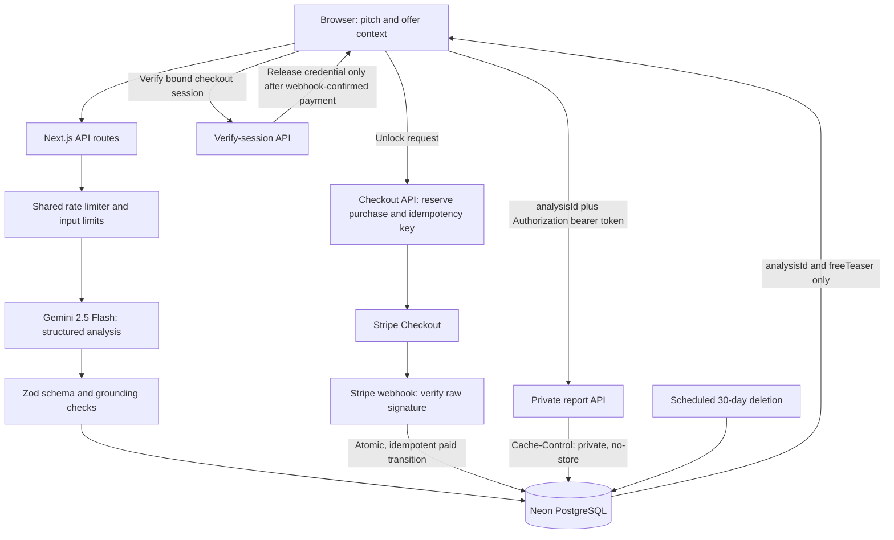

# OfferRoast

Status: **Milestone 1 prototype.** OfferRoast is an evidence-based diagnostic for B2B cold-outbound pitches. The current app is a local, rules-based first pass for testing the intake and teaser experience; it is not a model analysis, generic email rewriter, or conversion predictor.
In the planned production design, pitch content will be sent to the inference provider and reports stored temporarily; disclose both before submission. The current prototype does neither: inputs stay in the browser session and are analyzed by local rules. Later server-backed milestones must not log pitch/report content or credentials. Persist only what is needed, implement actual scheduled deletion, validate quote grounding in server code, and send report credentials in an Authorization header rather than a URL.

## Run the prototype

```sh
cd web
npm run dev
```

The first pass is deliberately heuristic. Gemini, Neon, and Stripe are not connected yet.

Run the Milestone 1 checks from `web/`:

```sh
npm test
npm run lint
npx tsc --noEmit
npm run build
```

The proposed beachhead is boutique B2B service businesses selling $2,000-$10,000/month retainers through cold email. The proposed $19 one-time report price is unvalidated. See [CLAUDE.md](CLAUDE.md) for the product requirements, grounding rules, architecture guardrails, and working agreements.

## Proposed architecture



The pitch is sent to the inference provider and report data is stored temporarily; disclose both before submission. Do not log pitch/report content or credentials. Persist only what is needed for the report, and implement actual scheduled deletion rather than relying on a TTL field. Validate quote grounding in server code; schema validation alone cannot establish that model claims are true. Use an Authorization header for the report token rather than putting it in a URL.

## Architecture review

The design holds for the MVP. Refinements to apply when each milestone starts:

- **Analysis is synchronous and bounded.** One Gemini call per request with a hard timeout and at most 2 regenerations. Return a clear failure rather than an unvalidated teaser.
- **Free tier is the abuse surface.** Each analysis costs inference money, so the shared rate limit (for example Upstash Redis or a Postgres counter) is needed in Milestone 3, not 4. A per-instance limit is not enough.
- **Generate the paid report lazily.** Generate only the teaser before payment and the five-objection report after the webhook confirms payment, so unpaid analyses cost less and the raw pitch need not be kept. This needs the pitch retained until payment, so decide this explicitly: either keep the pitch for the 30-day window (disclose it) or generate both parts up front and store both. The up-front option is simpler and keeps the pitch out of storage.
- **Pre-payment access is separate from paid access.** Use the public analysis ID plus a per-analysis token returned with the teaser only for deletion requests; the paid report token is issued after verification.
- **Deletion is a job.** Use a scheduled job (Vercel Cron or equivalent) that deletes rows older than 30 days, plus a user-triggered delete endpoint. Test both.
- **Shared grounding module.** Put exact-quote and 25-word checks in one server-only module used by every route. The current heuristic prototype's checks should move there and be reused.
- **Evaluation set lives outside the app database,** access-controlled, with consent records.

## Next steps

Milestone 2 is set up but not run: niche (outbound lead-gen agencies) and stop/go thresholds are locked in [docs/field-validation.md](docs/field-validation.md). Run about 20 consented sessions, log them in [the session CSV](docs/field-validation-sessions.csv), then `cd web && npm run tally -- ../docs/field-validation-sessions.csv`. No production integrations until that gate passes.

## Milestones

1. **Local prototype (complete):** pitch intake, deterministic teaser, exact-quote and word-limit tests, responsive browser check. No third-party calls or persistence.
2. **Field validation (next):** choose one service niche, set stop/go criteria, and test with roughly 20 qualified prospects using pitches only with permission. Review agreement with the diagnosis and willingness to pay before expanding scope.
3. **Grounded model analysis:** add a server-only Gemini route and structured output. Gate on schema, exact source-quote, prompt-injection, malformed-output, and labeled-case tests.
4. **Persistence and report access:** add Neon storage, no-store report delivery, credential checks, and actual 30-day deletion. Gate on access-control, data-leak, and deletion tests.
5. **Payment:** add Stripe checkout and webhook fulfillment. Gate on signature verification, correct amount/session binding, retry, race, and duplicate-event tests.

Run the milestone checks before moving to the next phase; stop for review at each gate. The next action is field validation of the current prototype, not production integrations.
